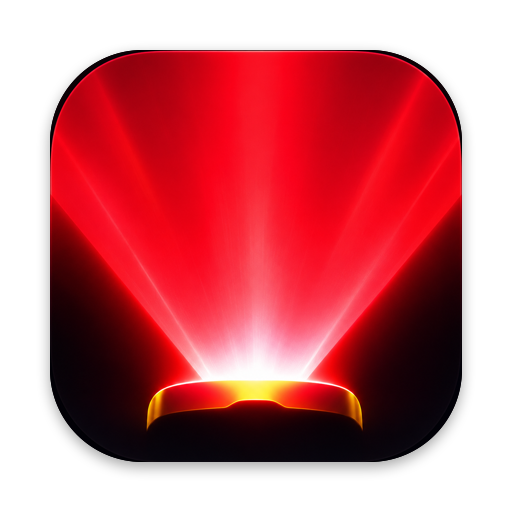
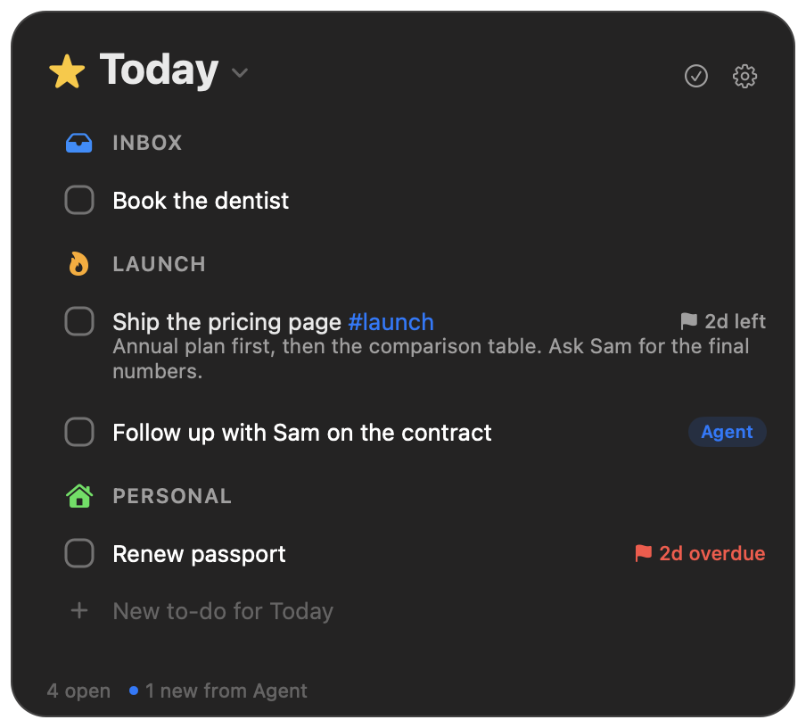
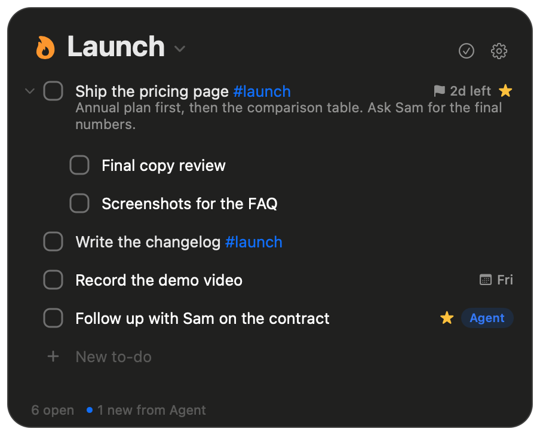
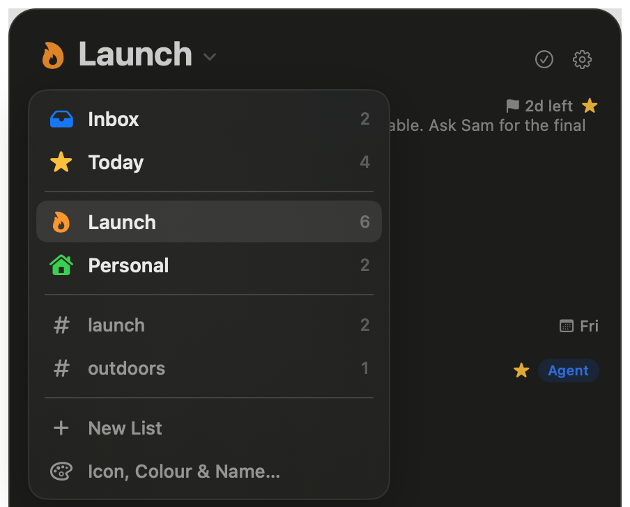
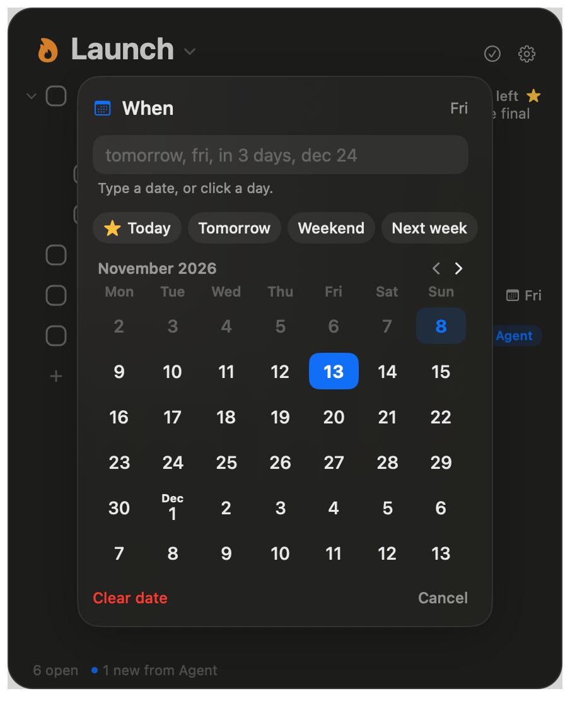

<p align="center"></p>

<h1 align="center">Laser Focus</h1>

<p align="center"><b>A to-do list that lives in your Mac's menu bar, and that your AI agent can write to.</b><br>
Workflowy's outline, Things' calm, one keystroke away. Your agent (Claude, Grok, ChatGPT, your own bot) adds and dates
to-dos over MCP while you work.</p>

<p align="center">


</p>

## Why this exists

I'm a founder. My to-dos lived in Workflowy, my plans in Things, and my AI agent kept telling me things I should do
in a chat I never reopened. Opening an app to write one line was enough friction that I stopped writing things down,
and I felt less productive every week.

So I built the smallest thing that fixes it for me:

- **Option-Space from anywhere**, type, Return. The list drops from the menu bar and the cursor is already there.
- **My agent writes to the same list.** It adds follow-ups after a call, stars what matters today, and reads what I
  ticked. Its items wear a small tag until I look at them.
- **Everything else stays out of the way.** No accounts, no team features, no sidebar. Your data lives on your own
  Cloudflare account, free tier.

It's built by a non-engineer with AI coding agents ("vibe coding"), with tests for everything that matters. If you're
building your own to-do app, **fork this instead of starting from zero**, and send back what you make better. Let's
build the best to-do list for makers, together.

## What it does

| | |
| --- | --- |
| **Outline** | Return splits a row, Tab nests it, Shift-Tab un-nests, Cmd-Period zooms in. Cmd-Z undoes everything. |
| **⭐ Today** | Cmd-T stars a to-do for today. Today groups them by list; starred items stay until you tick them. |
| **When / Deadline** | Cmd-S and Shift-Cmd-D. Type "fri", "in 3 days", "dec 24", or click a day. Overdue shows in red. |
| **#tags** | Write `#launch` anywhere. Click it, or type `#la` in the filter, to see every to-do with it across lists. Autocompletes. |
| **Notes** | Small grey text under a to-do. Shift-Return to write one. |
| **Lists** | Icons and colours, Inbox and Today on top, Cmd-1 to 9 to switch. |
| **Your agent** | 10 MCP tools: read lists, Today, search by text or tag, add (with dates), edit, tick, move. No delete. 60 writes a minute. |
| **Sync** | Writes are local first (works offline), then sync to your backend; agent changes show up in under a second. |
| **Settings** | Like Things: hide completed, menu bar count, appearance, text size, hotkey, launch at login, one-click agent setup. |

<p align="center">


</p>

## How it works

```
Your agent ──MCP /mcp (agent key)──┐
                                   ▼
            Cloudflare Worker ── Durable Object (SQLite: items + change log)
                                   │  ▲
         WebSocket "something changed"  /v1/ops push, /v1/sync pull (Mac key)
                                   ▼  │
            Mac app: local SQLite copy + queue of pending changes ── menu bar panel
```

- **Backend** (`backend/`, TypeScript): one Cloudflare Worker and one Durable Object. Every change gets a version in
  an append-only log, which powers sync, the agent's `get_changes`, and undo.
- **Mac app** (`mac/`, Swift 6, AppKit + SwiftUI): `Core/` is the tested model (local store, sync engine, outline
  editor, dates, tags); `App/` is the UI.
- **Two keys**: the Mac key can do everything; the agent key can only use MCP, can't delete, and can't touch lists.

More in [docs/ARCHITECTURE.md](docs/ARCHITECTURE.md) and [docs/MCP.md](docs/MCP.md).

## Set it up (about 15 minutes)

You need a Mac (macOS 14+), Xcode 16+, [pnpm](https://pnpm.io), [xcodegen](https://github.com/yonaskolb/XcodeGen)
(`brew install xcodegen`) and a free Cloudflare account. Full guide: [docs/SELF-HOSTING.md](docs/SELF-HOSTING.md).

```sh
git clone https://github.com/theGoillot/laser-focus-todo && cd laser-focus-todo

# 1. Backend
cd backend && pnpm install && npx wrangler login && pnpm run deploy
../scripts/setup-secrets.sh https://laser-focus.<your-subdomain>.workers.dev   # makes both keys

# 2. Mac app
cd ../mac && cp Local.xcconfig.example Local.xcconfig   # your Apple team id + bundle id
make install                                            # builds and opens "Laser Focus"
```

Paste the URL and `LASER_FOCUS_MAC_KEY` from `~/.config/laser-focus/mac.env` into the setup screen. Then
**Settings > Agent > Set Up Agent** and paste what it copies into your agent.

Using an AI coding agent? Point it at this repo and say "set up Laser Focus for me": [AGENTS.md](AGENTS.md) tells it how.

## Build on it

- Ideas and open problems: [docs/ROADMAP.md](docs/ROADMAP.md) (iPhone app, Upcoming view, notarized builds...).
- How to contribute (with or without an AI agent): [CONTRIBUTING.md](CONTRIBUTING.md).
- Found a security problem? [SECURITY.md](SECURITY.md).

MIT licensed. Fork it, change it, ship your own.
